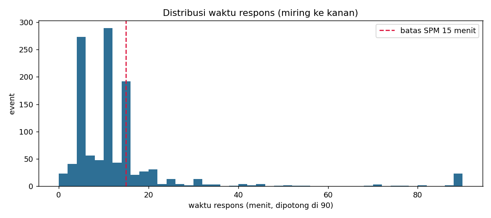
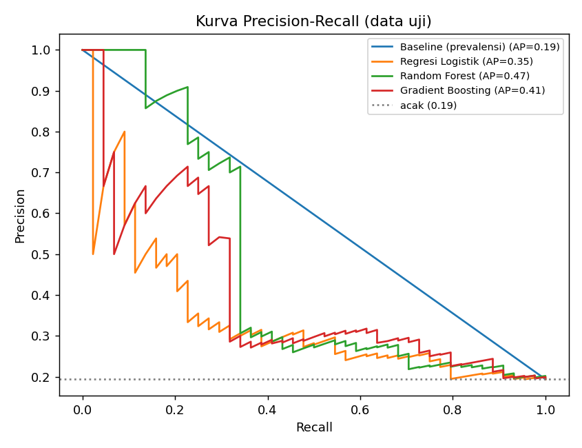
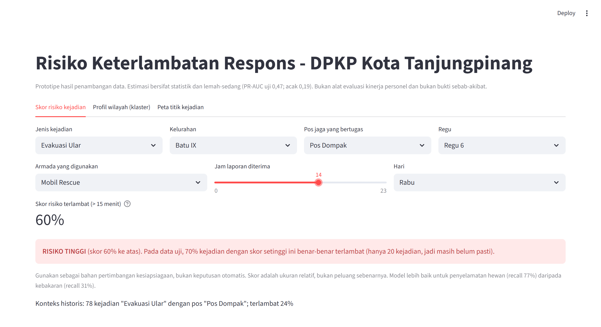

# Prediksi Risiko Keterlambatan Respons dan Klasterisasi Profil Risiko Wilayah

### Dinas Pemadam Kebakaran dan Penyelamatan (DPKP) Kota Tanjungpinang

> Dari 80.230 pesan grup WhatsApp menjadi 1.280 kejadian terstruktur, sebuah model yang memperkirakan kejadian yang berisiko melewati standar respons 15 menit, dan pengelompokan wilayah menurut profil kejadiannya. Dikerjakan menurut tahapan CRISP-DM dengan penekanan pada kejujuran hasil dan keterbatasannya.

Project mata kuliah **Penambangan Data (INF11121)**, Teknik Informatika, Universitas Maritim Raja Ali Haji, Ganjil 2026–2027.

---

## Ringkasan

DPKP mencatat setiap kejadian (kebakaran, evakuasi ular dan tawon, cincin tersangkut, dan lain-lain) sebagai pesan "LAPORAN KEJADIAN" di grup WhatsApp resmi. Standar pelayanan menetapkan respons **maksimal 15 menit** sejak laporan diterima sampai petugas tiba. Karena laporan berupa teks bebas, belum ada gambaran terstruktur tentang **seberapa sering, kapan, dan di mana** standar itu terlampaui.

Project ini menjawabnya dengan:

1. **Ekstraksi dan pembersihan** laporan dari chat, termasuk penyamaran data pribadi.
2. **Analisis eksplorasi data** untuk memahami kondisi dan masalah data.
3. **Klasifikasi**: memperkirakan apakah suatu kejadian berisiko terlambat (> 15 menit).
4. **Klasterisasi**: mengelompokkan titik kejadian dan 16 kelurahan menurut profilnya.
5. **Aplikasi prototipe** (Streamlit) yang menampilkan skor risiko dalam tiga tingkat.

> **Bukan** alat menilai kinerja petugas atau regu, dan **bukan** bukti sebab-akibat. Hasilnya bahan pertimbangan kesiapsiagaan.

## Hasil utama

| | Hasil |
|---|---|
| Kejadian unik hasil ekstraksi | **1.280** (dari 80.230 pesan, 1.308 pesan laporan) |
| Data berlabel untuk klasifikasi | 1.135 kejadian; **15,0% terlambat** |
| Model terbaik | Random Forest: PR-AUC uji **0,47** (menebak acak = 0,19), recall 0,59, precision 0,27 |
| Faktor yang terkait keterlambatan | jenis kejadian, pos/regu jaga, jam; lokasi kelurahan hampir tidak menambah |
| Kejadian bertitik koordinat | 207 (16,2%), hasil pencocokan pin lokasi; klaster tidak berbeda tingkat keterlambatannya (p = 0,49) |
| Klaster 16 kelurahan | 4 klaster, silhouette 0,34 (lemah): segmentasi deskriptif |

Waktu respons sangat miring dan dibulatkan petugas (70,6% kelipatan 5 menit; 174 kejadian tepat 15 menit):



Kurva Precision-Recall pada data uji (urut waktu, 227 kejadian):



## Hasil yang perlu dibaca dengan hati-hati

Model **lebih baik daripada menebak, tetapi lemah sampai sedang**. Hal-hal berikut dilaporkan apa adanya:

- **Evakuasi tawon/lebah** 39% terlambat (jenis lain 4–19%), dan 13 dari 17 data ekstrem (> 180 menit) adalah tawon. Laporan masuk pagi dan petugas tiba sore. *Dugaan (belum dikonfirmasi):* pemusnahan sarang dijadwalkan sore hari. Tanpa tawon, PR-AUC turun ke **0,29**; tanpa seluruh data ekstrem, ke **0,27**.
- **Model lemah untuk kebakaran:** hanya 31% keterlambatan kebakaran yang tertangkap (77% untuk penyelamatan hewan), padahal kebakaran inti standar.
- **Skor bukan peluang.** Skor 0,2–0,6 hanya sekitar 15–17% terlambat sebenarnya; hanya skor ≥ 0,6 yang sesuai kenyataan (70%, dari 20 kejadian). Karena itu aplikasi memakai tiga tingkat: **tinggi**, **perhatian**, **rendah**.
- **Definisi label sensitif.** Jika standar dibaca "kurang dari 15 menit" (bukan "sampai 15 menit"), jumlah terlambat naik dari 170 ke 344 kejadian.
- Hanya **44 kasus terlambat** di data uji; selang kepercayaan 95% PR-AUC 0,33–0,61.
- Label diturunkan dari jam yang diketik manual; `label_final` belum diperiksa dan sengaja dikosongkan.
- Klaster titik hanya mewakili 16,2% kejadian; kebakaran bangunan hanya 27 kejadian.

Rincian lengkap: [reports/klasifikasi_hasil.md](reports/klasifikasi_hasil.md), [reports/klaster_hasil.md](reports/klaster_hasil.md), [reports/eda_ringkasan.md](reports/eda_ringkasan.md), dan tabel pendukung di [reports/extras/](reports/extras/).

## Aplikasi prototipe

```bash
python -m streamlit run app/app.py
```

Pengguna memilih jenis kejadian, kelurahan, pos, regu, armada, jam, dan hari. Aplikasi menampilkan skor, tingkat risiko, dan konteks historis.



## Alur kerja (CRISP-DM)

| Tahap | Skrip | Keterangan |
|---|---|---|
| Data Understanding | `01_extract.py`, `02_link_pins.py` | membaca chat, mengambil laporan, mencocokkan pin lokasi (**butuh data privat**) |
| Data Preparation | `03_anonymize.py` | penyamaran data pribadi (**butuh data privat**) |
| Data Understanding (EDA) | `04_eda.py` | statistik dan 11 gambar |
| Data Preparation | `05_preprocess.py` | koreksi tanggal, normalisasi kelurahan dan jenis, label, fitur |
| Modeling dan Evaluation | `06_classify.py` | klasifikasi, validasi berurutan waktu, uji ketahanan |
| Modeling dan Evaluation | `07_cluster.py` | K-Means, DBSCAN, Ward, uji kestabilan |
| Deployment | `app/` | aplikasi Streamlit |
| Pelengkap | `08_package.py`, `14_report_extras.py` | paket 7z; tabel dan perhitungan pendukung |

Skrip `09`–`13` membangun dokumen internal tim (laporan, e-book, tangkapan layar) dan **tidak dapat dijalankan dari repositori ini** karena dokumennya tidak dipublikasikan.

## Struktur repositori

```
scripts/    kode bernomor sesuai urutan kerja + pustaka pendukung
app/        aplikasi Streamlit (antarmuka dan logika skor)
tests/      35 tes otomatis
data/
  mentah_anonim/   data hasil digitalisasi yang sudah disamarkan  (+ kamus data)
  siap_mining/     data siap mining dan hasil klaster              (+ kamus data)
models/     model Random Forest terlatih dan ambangnya
figures/    gambar EDA, model, klaster, dan aplikasi
reports/    ringkasan hasil (eda, klasifikasi, klaster) dan tabel pendukung (extras/)
docs/       dokumen desain dan rencana kerja
LOG.md      catatan kronologis semua keputusan, temuan, dan koreksi kesalahan
```

## Menjalankan ulang

Butuh Python 3.10. Versi pustaka dikunci agar hasil dapat diulang dan model terlatih dapat dimuat.

```bash
python -m venv .venv
source .venv/bin/activate        # Windows PowerShell: .venv\Scripts\Activate.ps1
pip install -r requirements.txt
```

Tahap 04 dan seterusnya hanya memakai data yang sudah disamarkan, sehingga siapa pun dapat menjalankannya:

```bash
python scripts/04_eda.py
python scripts/05_preprocess.py
python scripts/06_classify.py
python scripts/07_cluster.py
python -m pytest tests -q
```

Tahap 01–03 membutuhkan ekspor chat mentah yang **tidak dipublikasikan** dan hanya dapat dijalankan pemilik data.

**Reprodusibilitas.** Pada salinan bersih repositori ini (Windows, Python 3.10.11), tahap 04–07 menghasilkan 10 berkas keluaran yang identik dengan yang ada di repositori, dan 35 tes lolos. Nilai awal acak dikunci (42). Pada platform lain, hasil model dapat berbeda sangat tipis.

> **Peringatan:** jangan membuka lalu menyimpan ulang berkas CSV di folder `data/` dari Excel. Excel mengubah format tanggal dan membaca isian yang diawali tanda "-" sebagai rumus (menjadi `#NAME?`). Tahap 05 akan berhenti dengan pesan jelas bila format tanggal berubah.

## Data dan privasi

- **Yang dipublikasikan:** data hasil digitalisasi yang sudah **disamarkan** (`data/mentah_anonim/`) dan data siap mining (`data/siap_mining/`). Nama pelapor dan petugas, nomor telepon, alamat, dan RT/RW **tidak ada**; semuanya diganti kode yang konsisten (`PTG###`, `PLP####`, `ALM####`). Teks kronologis laporan tidak disertakan. Koordinat dibulatkan sekitar 110 meter.
- **Yang tidak dipublikasikan:** ekspor chat mentah, peta kode ke identitas asli, dan rekaman suara, karena memuat data pribadi.
- **Pemeriksaan:** pada berkas publik, 0 dari 222 nomor telepon dan 0 dari 708 nama lengkap asli ditemukan.
- **Izin:** publikasi data yang sudah disamarkan ini telah mendapat izin dari DPKP Kota Tanjungpinang (konfirmasi narasumber, November 2026).
- Kamus kolom: [data/mentah_anonim/KAMUS_DATA_MENTAH.md](data/mentah_anonim/KAMUS_DATA_MENTAH.md) dan [data/siap_mining/KAMUS_DATA_SIAP_MINING.md](data/siap_mining/KAMUS_DATA_SIAP_MINING.md).

Jika Anda menemukan data yang tampak mengidentifikasi seseorang, mohon laporkan lewat *issue* agar segera diperbaiki.

## Catatan proses

Seluruh keputusan, temuan, dan koreksi kesalahan yang terjadi selama pengerjaan, termasuk kesalahan pada pembaca pesan dan berkas data yang rusak karena Excel, dicatat apa adanya di [LOG.md](LOG.md).

## Tim

| NIM | Nama |
|---|---|
| 2401020051 | Abdul Hafidz (ketua) |
| 2401020011 | Bayu Adhandika |
| 2401020090 | Adib Farhan Sihombing |
| 2401020058 | Muhammad Rahman Afrialdi |
| 2401020084 | Vito Hendriansyah |

## Lisensi

Belum ada lisensi terbuka yang ditetapkan, sehingga hak cipta tetap pada tim. Silakan membaca dan merujuk untuk keperluan belajar; hubungi tim sebelum memakai ulang kode atau data.
